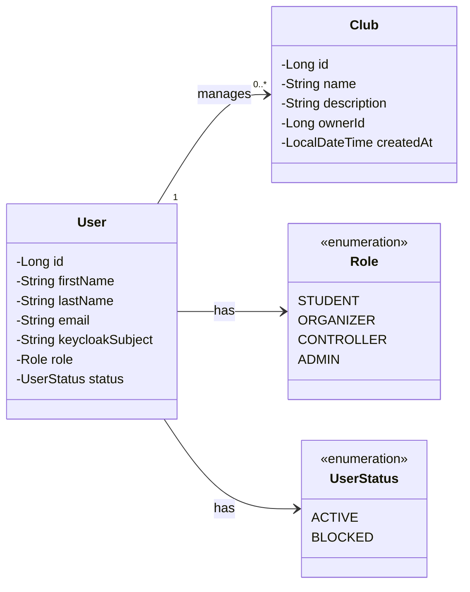

# EventTun — User Service Class Diagram

## 1. Description

The User Service manages user profiles and university clubs.

It contains two main entities:

- **User**: represents a student, organizer, controller, or administrator.
- **Club**: represents a university club managed by an organizer.

## 2. UML Class Diagram

## 3. Relationship Between User and Club

The relationship is one-to-many (1:N).

- One user can manage multiple clubs.
- Each club has one responsible user.
- The Club.ownerId field references User.id.

In the current Java implementation, ownerId is stored
as a Long identifier. The UML relationship represents
the intended business relationship, not an implemented
JPA association.

## 4. Database Design

Database name: users_db

Current local database: H2

Target database: MySQL

Tables:
- users
- clubs

Each microservice manages its own database to ensure data isolation, independent development, and maintainability.

## 5. Authentication

Keycloak is planned as the authentication provider.

User Service stores user profile information and does
not manage passwords.

The keycloakSubject attribute will link a user profile
to a Keycloak identity in the target architecture.

Keycloak integration is not implemented for Validation 1.
