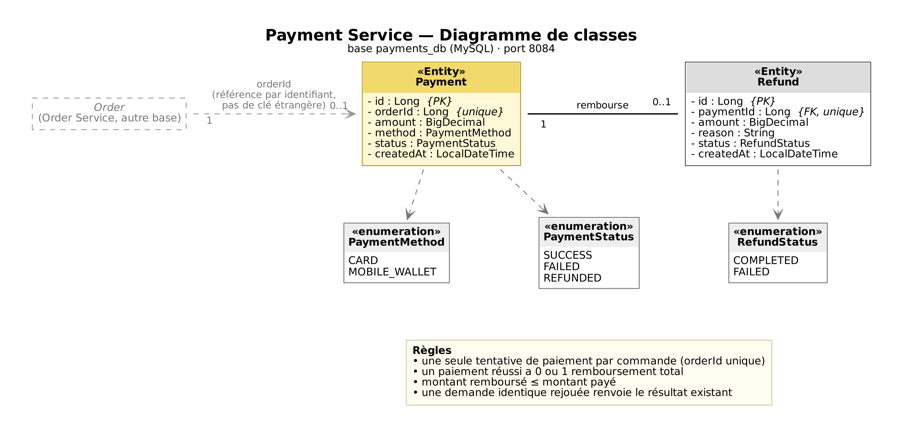

# Fiche technique — Payment Service

Responsable : M4 — Chaima Kamel

## 1. Nom du microservice

`payment-service` — dossier `Backend/payment-service/`, branche `feature/payment-service`.

## 2. Responsable

M4 — Chaima Kamel.

## 3. Description et responsabilités

Payment Service gère les **paiements simulés** des commandes et leurs **remboursements**. Aucun paiement bancaire réel n'est effectué.

Il est appelé uniquement par Order Service pendant le parcours d'achat et n'appelle lui-même aucun autre service. Il ne gère ni les commandes, ni les places, ni les billets.

## 4. Fonctionnalités

- Effectuer un paiement simulé pour une commande (accepté `SUCCESS` ou refusé `FAILED`).
- Consulter un paiement par son identifiant.
- Retrouver le paiement d'une commande par `orderId` (utilisé par Order après un timeout).
- Rembourser un paiement réussi (compensation de la Saga ou annulation).
- Consulter les remboursements d'un paiement.

Version 1 : une seule tentative de paiement par commande, au plus un remboursement total par paiement.

## 5. Entités et attributs

### Payment

| Attribut | Type | Contrainte / rôle |
|---|---|---|
| id | Long | Clé primaire |
| orderId | Long | Unique : une seule tentative par commande |
| amount | BigDecimal | Montant > 0 |
| method | Enum `PaymentMethod` | `CARD`, `MOBILE_WALLET` |
| status | Enum `PaymentStatus` | `SUCCESS`, `FAILED`, `REFUNDED` |
| createdAt | LocalDateTime | Date de création |

### Refund

| Attribut | Type | Contrainte / rôle |
|---|---|---|
| id | Long | Clé primaire |
| paymentId | Long | Référence le paiement ; unique (0 ou 1 remboursement) |
| amount | BigDecimal | Inférieur ou égal au montant payé |
| reason | String | Motif (ex. échec de l'émission des billets) |
| status | Enum `RefundStatus` | `COMPLETED`, `FAILED` |
| createdAt | LocalDateTime | Date de création |

**Relation** : un paiement réussi possède zéro ou un remboursement total. `orderId` référence une commande d'Order Service par simple identifiant, sans clé étrangère, car la commande est stockée dans une autre base.

## 6. Diagramme de classes



Fichier : `Documentation/Diagrams/classes-payment.png`

## 7. Base de données

**payments_db (MySQL)**, deux tables :

- `payments` : contrainte unique sur `order_id` ;
- `refunds` : contrainte unique sur `payment_id`.

MySQL est choisi pour la cohérence transactionnelle entre un paiement et son remboursement. Les contraintes d'unicité empêchent la création de doublons au niveau de la base ; la gestion des requêtes répétées (renvoyer le résultat existant) sera assurée par la logique du service.

Validation 1 : le service démarre sur **H2 en mémoire** ; la configuration MySQL est préparée en commentaire dans `application.properties`.

## 8. Technologies

Java 17, Spring Boot 3.5, Spring Web, Spring Data JPA, Bean Validation, Spring Boot Actuator, springdoc-openapi (Swagger UI), H2, MySQL Connector/J, Maven.

## 9. Architecture interne du code

```
com.eventtun.payment
├── PaymentServiceApplication.java     point d'entrée Spring Boot
├── config/OpenApiConfig.java          informations Swagger
├── controller/PaymentController.java  endpoints REST /api/payments
├── service/PaymentService.java        règles métier
├── repository/                        PaymentRepository, RefundRepository (JPA)
├── entity/                            Payment, Refund + énumérations
└── dto/                               PaymentRequest, RefundRequest (validation)
```

Le controller reçoit la requête HTTP et valide le corps (DTO), le service applique les règles, le repository accède à `payments_db`.

## 10. Endpoints REST

| Méthode | URI | Description | Codes |
|---|---|---|---|
| POST | `/api/payments` | Effectuer un paiement simulé | 201, 200 (rejeu identique), 400, 409 |
| GET | `/api/payments/{id}` | Consulter un paiement | 200, 404 |
| GET | `/api/payments?orderId=` | Paiement d'une commande | 200 |
| POST | `/api/payments/{id}/refunds` | Demander un remboursement | 201, 200 (rejeu identique), 400, 404, 409 |
| GET | `/api/payments/{id}/refunds` | Consulter les remboursements | 200, 404 |

## 11. Exemples de requêtes et réponses JSON

**Paiement accepté** — `POST /api/payments`

```json
{ "orderId": 42, "amount": 90.00, "method": "CARD" }
```

Réponse `201 Created`, en-tête `Location: /api/payments/7` :

```json
{ "id": 7, "orderId": 42, "amount": 90.00, "method": "CARD",
  "status": "SUCCESS", "createdAt": "2026-11-14T15:20:00" }
```

**Paiement refusé** — réponse `409 Conflict` (`application/problem+json`) :

```json
{ "type": "about:blank", "title": "Conflict", "status": 409,
  "detail": "Paiement refusé pour la commande 42", "instance": "/api/payments" }
```

**Remboursement** — `POST /api/payments/7/refunds`

```json
{ "amount": 90.00, "reason": "Échec de l'émission des billets" }
```

Réponse `201 Created` :

```json
{ "id": 3, "paymentId": 7, "amount": 90.00,
  "reason": "Échec de l'émission des billets",
  "status": "COMPLETED", "createdAt": "2026-11-14T15:25:00" }
```

## 12. Codes HTTP et erreurs

| Code | Situation |
|---|---|
| 200 OK | Lecture réussie ; ou rejeu identique d'un paiement `SUCCESS` ou d'un remboursement existant (aucun nouveau débit) |
| 201 Created | Paiement accepté ou remboursement créé ; en-tête `Location` |
| 400 Bad Request | Corps invalide (champ manquant, montant ≤ 0) ; remboursement supérieur au montant payé |
| 404 Not Found | Paiement inexistant |
| 409 Conflict | Paiement simulé refusé (choix commun de l'équipe, pas de 422) ; rejeu d'un paiement `FAILED` ; même `orderId` avec un montant différent ; paiement non remboursable |
| 500 / 503 | Erreur interne / service indisponible (côté appelant : timeout) |

Toutes les erreurs suivent le format **Problem Details** (`type`, `title`, `status`, `detail`, `instance`), sans trace d'exécution ni message SQL.

## 13. Interactions avec les autres microservices

| Sens | Service | Mode | Échange |
|---|---|---|---|
| Entrant | Order → Payment | Synchrone REST / OpenFeign | `POST /api/payments` : orderId, amount, method → statut du paiement |
| Entrant | Order → Payment | Synchrone | `GET /api/payments?orderId=` : vérifier un paiement après un timeout |
| Entrant | Order → Payment | Synchrone | `POST /api/payments/{id}/refunds` : compensation de la Saga |
| Sortant | — | — | Payment n'appelle aucun service |

**Pourquoi synchrone ?** Le résultat du paiement conditionne la suite : Order ne peut ni confirmer les places ni émettre les billets sans le connaître.

**Asynchrone** : Payment ne publie aucun événement. C'est Order qui publie `OrderConfirmed` vers Notification Service.

**Panne** : si Payment est arrêté ou si sa réponse se perd, Order reçoit un timeout, le circuit breaker évite de saturer le service et Order répond 503. Avant toute nouvelle tentative ou compensation, Order consulte `GET /api/payments?orderId=` : pas de double paiement.

## 14. Documentation Swagger

Contrat généré par springdoc-openapi à partir des annotations du controller (`@Operation`, `@ApiResponse`).

- Swagger UI : http://localhost:8084/swagger-ui.html
- Contrat JSON : http://localhost:8084/v3/api-docs

Les cinq opérations y figurent avec leurs codes de réponse.

## 15. Scénarios de tests prévus (résultats réels seulement après implémentation)

| Scénario | Requête | Résultat attendu |
|---|---|---|
| Paiement accepté | `POST /api/payments` {orderId: 42, amount: 90.00} | 201, status `SUCCESS` |
| Rejeu identique | Même requête une seconde fois | 200, même paiement, pas de second débit |
| Paiement refusé | `POST /api/payments` (simulation de refus) | 409, paiement enregistré `FAILED` |
| Montant différent | `POST /api/payments` {orderId: 42, amount: 50.00} | 409 |
| Remboursement | `POST /api/payments/7/refunds` {amount: 90.00} | 201, paiement `REFUNDED` |
| Remboursement excessif | `POST /api/payments/7/refunds` {amount: 200.00} | 400 |
| Paiement inexistant | `GET /api/payments/999` | 404 |

## 16. Limites et perspectives

- Paiement simulé : pas d'intégration avec une passerelle bancaire réelle.
- Version 1 : une seule tentative par commande, un seul remboursement total, pas de remboursement partiel.
- État actuel : projet qui démarre, entités, repositories, endpoints GET et Swagger ; les endpoints POST renvoient 501.
- Étapes suivantes : simulation du paiement et idempotence, passage à MySQL, enregistrement dans Eureka, configuration via Config Server, sécurisation JWT (Keycloak) derrière l'API Gateway, tests unitaires et d'intégration.
